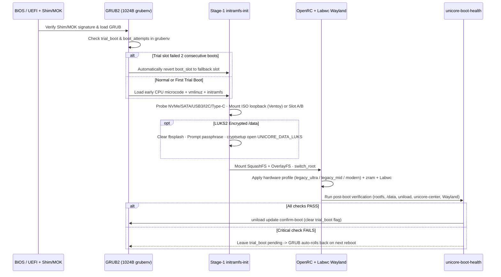
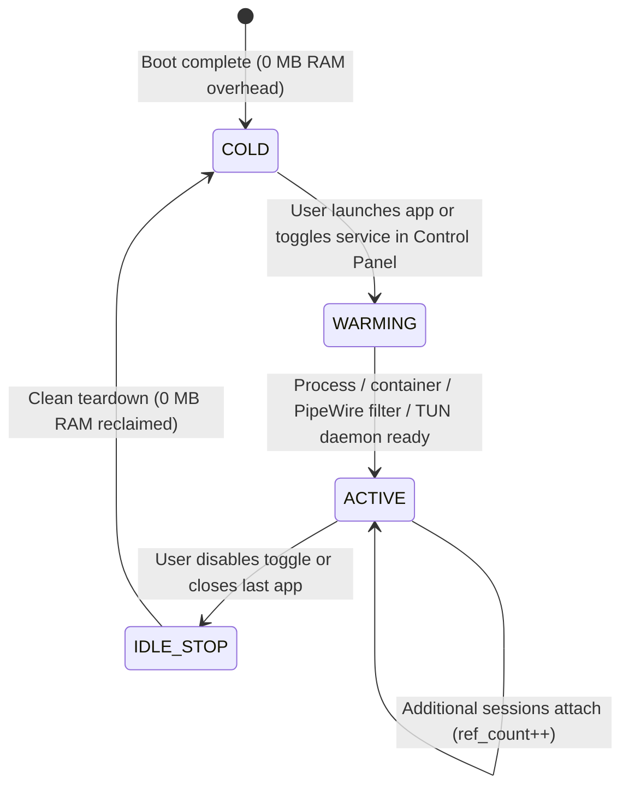

# UniCore OS — System Architecture Specification (`v2.0.0`)

**Document ID:** `UC-ARCH-2.0`  
**Applies To:** UniCore OS `v2.0.0` (`x86_64` & `aarch64`)  
**Base Platform:** Alpine Linux 3.22 (`musl`) · Linux Kernel 6.15 (`linux-edge`) · Mesa 25.1 · Wayland (`labwc`) · PipeWire · Rust + Slint + C++17

---

## 1. Architectural Overview

UniCore OS is designed as a **layered, immutable, zero-trust desktop operating system** that unifies native Linux (`ELF` / `Flatpak`), Classic & Modern Desktop PC (`.exe` / `.msi` / 16-bit `NE` / `MS-DOS`), Web Apps (`PWA`), and Mobile (`.apk`) execution alongside native Post-Quantum VPN networking (**AegisTunnel**) and real-time audio signal processing (**ResonanceFX**) — while maintaining a sub-250 MB desktop idle footprint.

```mermaid
flowchart TB
    subgraph L5["Layer 5 — Desktop Shell & Sovereign GUI"]
        Center["unicore-center (Rust + Slint, ~22 MB RSS)<br/>Control Panel · Start Menu · Store · Settings · Device/Storage Mgr · VPN · EQ"]
        Shell["Wayland Desktop Stack<br/>labwc · waybar · pcmanfm · fuzzel · mako · wob · swaylock-effects"]
    end

    subgraph L4["Layer 4 — Native Engines & On-Demand Subsystems (0 MB Idle)"]
        Uniload["uniload (Static Rust Orchestrator)<br/>Binary Inspector · bwrap Planner · A/B OTA · Ed25519 · Gamepad uinput"]
        Aegis["unicore-aegis-vpn (Static Rust)<br/>WireGuard · AmneziaWG Anti-DPI · REALITY TCP/443 · ML-KEM-768 · DNS Sinkhole"]
        ResFX["libunicore_resonance_fx.so (C++17 LADSPA 1.1)<br/>10-Band EQ · Pure Bass · Clarity · 3D Surround · 8D Orbit · UPOLA Convolver"]
        Compat["Compatibility Runtimes<br/>Wine 10.7 + DXVK/VKD3D/cnc-ddraw/OTVDM · DOSBox-Staging · Box64 (ARM64) · Waydroid · Flatpak"]
    end

    subgraph L3["Layer 3 — Media, IPC & Privilege Boundaries"]
        PW["PipeWire + WirePlumber + pipewire-alsa + SPA BlueZ"]
        NM["NetworkManager + nftables Stateful Firewall + Avahi mDNS"]
        SysHelper["doas + /usr/libexec/unicore-sys-helper (Strictly Whitelisted Root Actions)"]
        Sandbox["/usr/libexec/uniload-sandbox-exec (bubblewrap Namespaces + Cap Drop)"]
    end

    subgraph L2["Layer 2 — Immutable Storage & Boot Control"]
        Slots["Read-Only A/B Slots: UNICORE_SYS_A / UNICORE_SYS_B (SquashFS)"]
        Overlay["OverlayFS Runtime Merge + Persistent /data (Optional LUKS2)"]
        BootHealth["GRUB2 (BIOS + UEFI Shim/MOK) + 1024B grubenv + unicore-boot-health"]
    end

    subgraph L1["Layer 1 — Kernel & Hardware Abstraction"]
        Kernel["linux-edge 6.15 (binderfs · binfmt_misc · zram · overlayfs · tun · nftables)"]
        Firmware["Early intel-ucode / amd-ucode · Mesa 25.1 (NVK Vulkan 1.4 + GSP) · SOF Audio · Wi-Fi/BT Firmware"]
    end

    L5 --> L4
    L4 --> L3
    L3 --> L2
    L2 --> L1
```

---

## 2. Partition Layout & Immutable Storage Model

On bare-metal GPT installations (`unicore-install`), UniCore OS enforces strict separation between the **immutable OS image** and **mutable user/application state**:

| Partition / Label | Filesystem | Mount Point | Writability | Role |
| :--- | :--- | :--- | :--- | :--- |
| `EFI` (ESP) | FAT32 (`>= 256 MiB`) | `/boot/efi` | Read-Write (Admin) | UEFI Shim (`BOOTX64.EFI`/`BOOTAA64.EFI`), MOK Manager, signed `grub*.efi`, `grubenv` |
| `BIOS_BOOT` (x86_64) | Raw `ef02` (`2 MiB`) | *(unmounted)* | Bootloader | Legacy BIOS GRUB Stage-1.5 core image for hybrid BIOS+UEFI boot |
| `UNICORE_SYS_A` | `ext4` containing SquashFS + kernel + initramfs | `/mnt/sys` (Active A) | **Read-Only** | Immutable OS Slot A (`vmlinuz`, `initramfs`, `unicore-rootfs.squashfs`) |
| `UNICORE_SYS_B` | `ext4` containing SquashFS + kernel + initramfs | *(Standby B)* | **Read-Only** | Immutable OS Slot B target for zero-downtime A/B OTA updates & rollback |
| `UNICORE_DATA` or `UNICORE_DATA_LUKS` | `ext4` (or LUKS2 → `ext4`) | `/data` | Read-Write | Persistent `/data/home`, `/data/sandboxes`, `/data/flatpak`, `/data/network`, `/data/overlay`, `/data/ai` |

### OverlayFS Merge & Non-Destructive OS Reset
At Stage-1 boot, `os-builder/initramfs-init` mounts the active SquashFS rootfs as the read-only `lowerdir`, binds `/data/overlay/upper` and `/data/overlay/work` (or `tmpfs` in Live USB RAM mode) as the writable layer, and exposes `/data/home` cleanly at `/home/unicore`. Passing `unicore_reset_overlay=1` via the GRUB Recovery entry wipes `/data/overlay` to restore factory OS configuration while preserving `/data/home`, `/data/sandboxes`, and user documents intact.

---

## 3. Boot Sequence & Health-Gated A/B Auto-Rollback

---

## 4. On-Demand `0 MB`-Idle Subsystem Lifecycle

To keep UniCore OS responsive even on `512 MB–2 GB` legacy systems and extend laptop battery life on modern hardware, all heavy subsystems obey an explicit **cold-by-default** state machine:

| Subsystem | Activation Mechanism | Idle Boot RAM | Clean Teardown Mechanism |
| :--- | :--- | :--- | :--- |
| **AegisTunnel VPN** | `doas unicore-sys-helper aegis-start` | `0 MB` | `aegis-stop` (`SIGTERM`, removes `aegis0` TUN) |
| **ResonanceFX PipeWire DSP** | `unicore-resonance-ctl start` | `0 MB` | `unicore-resonance-ctl stop` (tears down virtual sink) |
| **CUPS Printing** | `doas unicore-sys-helper cups-start` | `0 MB` | `cups-stop` |
| **Bluetooth (`bluetoothd`)** | On-demand or hardware `hci*` detection (skipped on `legacy_ultra`) | `0 MB` | `bt-stop` |
| **Phone Link (`kdeconnectd`)** | `unicore-phone start` | `0 MB` | `unicore-phone stop` |
| **Local AI (`ollama`)** | `unicore-ai` when local provider selected | `0 MB` | Stops idle daemon / cloud API uses `0 MB` local RAM |
| **LVFS Firmware (`fwupd`)** | Manual scan in Hardware & Drivers | `0 MB` | On-demand CLI execution only |
| **Win32 (`wine`) / Mobile (`waydroid`)** | `uniload launch <app_id>` | `0 MB` | `uniload reclaim` / container stop |

---

## 5. Multi-Format Execution Engine (`uniload`)

`core/orchestrator` compiles to a single static musl binary (`/usr/bin/uniload`) with zero runtime interpreter dependencies:

1. **Binary Inspection (`uniload inspect <file>`):** Reads magic headers directly to classify:
   - `PE32` / `PE32+` (`.exe`, `.msi`) — extracts `MajorSubsystemVersion` to auto-select `Win98` (`<= 4.x`), `WinXP` (`5.x`), `Win7` (`6.1`), or `Win10` (`>= 6.2`) eras.
   - `NE` 16-bit (`.exe`) — routed to `OTVDM` (`otvdm.exe`) inside Wine.
   - `MZ` Pure MS-DOS (`.exe`, `.com`, `.bat`) — routed to embedded `DOSBox-Staging` (`uniload-dos`).
   - `ZIP` / `APK` (AndroidManifest + DEX) — routed to `Waydroid` ART container (`binderfs` multi-window).
   - `ELF` (`x86_64` / `aarch64`) — native Linux execution inside `bwrap` with `--unshare-pid`.
2. **Legacy Game Auto-Tune (`--retro-game`):** 5 simplified profiles (`Smart Auto`, `90s 2D Classic` via `cnc-ddraw`, `2000s 3D Classic` via `DXVK v2.4.1` with OpenGL fallback, `Retro DOS / 16-Bit`, `Ultra-Safe Legacy`) automatically configure `UNICORE_SINGLE_CORE=1` (`taskset -c 0`), `UNICORE_FPS_CAP_60=1`, `UNILOAD_VIRTUAL_DESKTOP`, and rootless CD `.iso` mounting (`D:\`).
3. **ARM64 Win32 Runtime (`aarch64`):** Bundles an isolated `glibc 2.39` sysroot under `/usr/share/unicore/arm64-win32/` with `Box64 v0.4.4` (64 KB-aligned low-address prereserve patch for Wine 11+) and `Wine 11.0 WoW64` without polluting Alpine's native `musl` system libraries.

---

## 6. Embedded Native Engines (`v1.6.0`–`v2.0.0`)

### 6.1 AegisTunnel Post-Quantum VPN (`core/aegis-proto` + `core/aegis-vpn`)
Compiled as a static musl binary (`/usr/bin/unicore-aegis-vpn`) backed by `/usr/libexec/unicore-aegis-ctl`:
- **Data Plane:** Userspace WireGuard (`boringtun` + `x25519-dalek`) attached directly to a native Linux `/dev/net/tun` interface (`aegis0`, `IFF_TUN | IFF_NO_PI`, MTU `1280`).
- **Anti-DPI & Stealth Transport:** Wraps datagrams with **AmneziaWG** junk packet/header obfuscation (`Jc`/`Jmin`/`Jmax`/`S1`/`S2`/`H1`–`H4`) and provides **Happy Eyeballs** automatic failover to **REALITY TLS 1.3 TCP/443** mimicry when UDP is throttled or blocked, with automatic UDP recovery probing.
- **Hybrid Post-Quantum Key Exchange:** Combines classical `X25519` with **NIST FIPS 203 `ML-KEM-768`** (`ml-kem` crate) to derive rotating session PSKs; `SIGHUP` triggers immediate live PQ epoch rotation without dropping active flows.
- **Local DNS Sinkhole & Zero-Drop Handover:** Intercepts IPv4/IPv6 DNS queries inside the tunnel to block ad/tracker domains locally (`0.0.0.0` / `::`) and performs make-before-break path scoring across network changes.

### 6.2 ResonanceFX PipeWire Equalizer & Spatial DSP (`core/resonance-fx`)
Compiled natively for Alpine 3.22 `musl` as a header-free **LADSPA 1.1** stereo shared plugin (`/usr/lib/ladspa/libunicore_resonance_fx.so`, label `unicore_resonance_fx`), activated on demand by `/usr/libexec/unicore-resonance-ctl` via PipeWire's `libpipewire-module-filter-chain` (`unicore_resonance_fx_sink`):

```mermaid
flowchart LR
    In["PipeWire Stereo Input<br/>(FL / FR, 48 kHz f32)"] --> EQ["10-Band Coupled<br/>Graphic EQ (DF1)"]
    EQ --> Bass["Pure Bass +<br/>Sub-300Hz Protector"]
    Bass --> Clar["Silky Clarity +<br/>Harmonic Exciter"]
    Clar --> Conv["UPOLA FFT<br/>Convolver IR (512-blk)"]
    Conv --> Tube["Analog Tube<br/>Warmth Stage"]
    Tube --> Bin["Binaural Crossfeed /<br/>8D Spatial Orbit"]
    Bin --> Surr["Zero-Comb 3D<br/>Haas Surround"]
    Surr --> Mod["Stereo Chorus<br/>& Delay"]
    Mod --> Rev["Schroeder<br/>Stereo Reverb"]
    Rev --> Lim["Loudness + Peak-Hold<br/>Smooth Limiter"]
    Lim --> Out["PipeWire Master Output<br/>(Hardware Sink)"]
```

- **Hot-Reload Parameter Bridge:** `unicore-center --equalizer` persists user presets to `/data/home/.config/unicore/resonance-fx.conf` and mirrors them to `$XDG_RUNTIME_DIR/unicore-resonance-fx.conf`. The LADSPA plugin polls `stat()` mtime/size every 8192 frames (~170 ms) and pushes lock-free seqlock updates into `WinDspCore` without clicks or restarting PipeWire.

---

## 7. Desktop Personalization & Internationalization Layer

- **8-Layer Cohesive Theme Engine (`unicore-personalize`):** Atomically synchronizes `swaybg` wallpaper, `waybar` CSS/layout (`centered`/`classic`/`dock`), `labwc` Openbox window decoration + corner radius (`0px`–`12px`), GTK3 theme + `Papirus` icons, `fuzzel`, `foot`, `mako`, and Slint `UiTheme` tokens across 10 curated themes.
- **Global Input & Locale (`--region`):** Manages 12 international locales, 32 IANA timezones, 24h/12h Waybar clock formatting, and 21 XKB keyboard layouts (automatically configuring `XKB_DEFAULT_LAYOUT=us,<layout>` + `XKB_DEFAULT_OPTIONS=grp:alt_shift_toggle` for non-Latin scripts such as Arabic, Cyrillic, Japanese, Korean, Chinese, and Thai alongside pre-bundled `font-noto-arabic` and `font-wqy-zenhei`).
