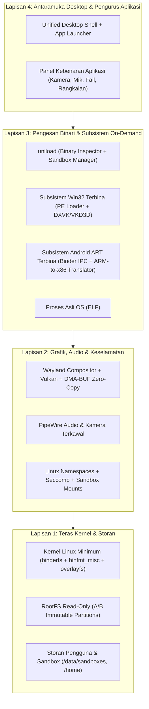
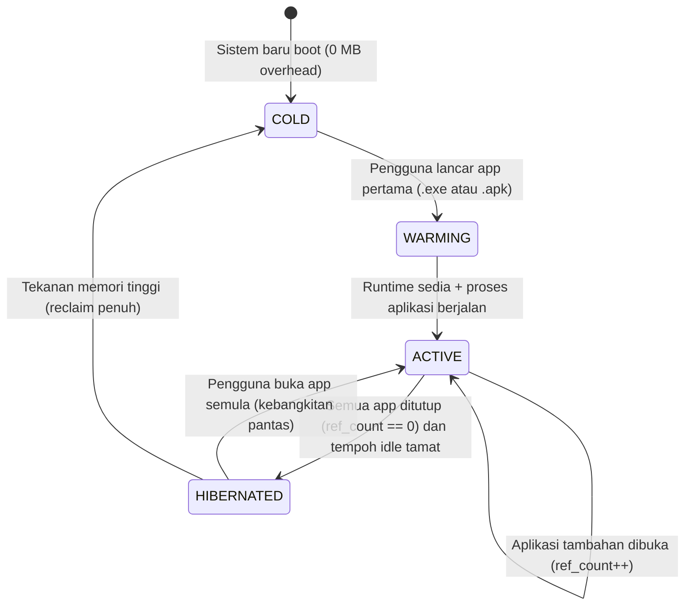

# Spesifikasi Seni Bina: Universal OS Ringan (`.exe` + `.apk` Terbina)

Dokumen ini mentakrifkan seni bina rujukan bagi sistem pengendalian desktop yang **ringan, pantas, kalis rosak (*immutable*), dan menyokong aplikasi Windows (`.exe`/`.msi`) serta Android (`.apk`) secara langsung tanpa pelancar pihak ketiga**.

---

## 1. Prinsip Reka Bentuk Utama

1. **Tiada Pelancar Pihak Ketiga Di Peringkat Pengguna (*Zero-Config UX*):**
   Pengguna mengurus fail `.exe` dan `.apk` sebagai aplikasi kelas pertama (*first-class citizens*). Pengesanan format dan pengaktifan persekitaran larian berlaku terus di lapisan pemuat sistem (`binfmt_misc` + binari asli Rust `uniload` tanpa sebarang kebergantungan runtime Python di dalam *rootfs*).
2. **Subsistem *On-Demand* (Jimat RAM & Pantas Saat Boot):**
   Semasa *boot*, hanya kernel minimum, pelayan grafik Wayland/Vulkan, dan audio PipeWire dimuatkan. Subsistem Win32 dan Android ART kekal dalam keadaan `COLD` (0 MB RAM tambahan) sehingga pengguna benar-benar membuka aplikasi `.exe` atau `.apk`.
3. **Teras *Immutable* + *Zero-Trust Sandbox*:**
   Fail teras OS dipaut secara *read-only* (`EROFS` / `SquashFS`). Setiap aplikasi `.exe` dan `.apk` dikurung di dalam direktori *sandbox* terasing dengan kebenaran eksplisit (*permissions manifest*).
4. **Paip Grafik Tunggal (*Zero-Copy Vulkan Pipeline*):**
   Semua aplikasi — sama ada asli (`ELF`), Windows (DirectX → Vulkan), atau Android (GLES/Vulkan → Vulkan) — berkongsi kompositor Wayland dan pemacu GPU fizikal yang sama melalui `DMA-BUF`.

---

## 2. Susunan 4 Lapisan Sistem

---

## 3. Susun Atur Partisi & Sistem Fail

| Partisi / Laluan | Jenis | Tujuan |
| :--- | :--- | :--- |
| `/boot/efi` | FAT32 | Pemuat but UEFI + kernel + initramfs |
| `system_a` / `system_b` | `SquashFS` / `EROFS` (*Read-Only*) | Teras OS *immutable* + kemas kini A/B dengan keupayaan undur (*rollback*) |
| `/data/sandboxes/<app_id>` | `ext4` / `btrfs` (*Read-Write*) | Persekitaran terasing setiap aplikasi (`.exe` prefix, `.apk` data, `permissions.json`) |
| `/home/<user>` | `ext4` / `btrfs` | Fail dokumen & muat turun pengguna (dikongsi hanya jika diberi izin) |

---

## 4. Kitaran Hayat Subsistem *On-Demand*

Untuk memastikan OS kekal lebih ringan daripada Windows dan distro desktop biasa, subsistem keserasian menggunakan mesin keadaan berikut:

---

## 5. Pengesanan Binari & Strategi CPU (`x86_64` & `ARM64`)

* **Sasaran Fasa 1–4 (`x86_64` Baseline 2005–Sekarang):**
  * **Sokongan Perkakasan Zaman 2005 Hingga Sekarang (`uniload hw-profile`):**
    * Binari OS dan Rust `uniload` menyasarkan **`x86-64-v1`** (berjalan pada CPU 64-bit dari era 2005 seperti Athlon 64 / Pentium 4 EM64T / Core 2 Duo tanpa memerlukan SSE4.2 atau AVX; bagi CPU 32-bit tulen pra-2006 seperti Pentium M/Atom lama, skrip binaan menyokong `TARGET_ARCH=x86`).
    * **Boot Hibrid BIOS + UEFI (`unicore-os-x86_64.iso`):** Satu imej ISO/USB menyokong papan induk **Legacy BIOS (2005–2011)** dan **UEFI (2012–sekarang)** serta pemacu storan PATA/IDE, SATA AHCI, NVMe, dan USB 1.1–3.x. Mod *Live RAM* tidak menyentuh cakera keras asal pengguna melainkan partisi berlabel `UNICORE_DATA` wujud.
    * **Profil Adaptif & `zram` Automatik:** `legacy_ultra` (<1.5 GiB RAM: `75%` swap `zram`, `WLR_RENDERER=pixman`, `gdi-legacy`, bar ringan), `legacy_mid` (1.5–3.5 GiB / tiada Vulkan: `50%` `zram`, `gles2`, `wined3d-opengl`), dan `modern` (>=4 GiB + Vulkan: `dxvk+vkd3d`, `vulkan-dma-buf`).
  * **Sokongan Berbilang Era Windows (Win98 + WinXP + Moden):** `uniload` membaca pengepala `MajorSubsystemVersion` (`PE32`/`PE32+`) serta binari 16-bit `NE` (`MZ`+`NE`) untuk mengklasifikasikan aplikasi kepada profil **`win98`** (versi `<= 4.x`, mod *virtual desktop* `800x600`, DirectDraw GDI/kompatibel untuk game klasik + cangkuk `otvdm.exe` Win16 apabila dipasang), **`winxp`** (versi `5.x`, Direct3D 8/9 + DirectSound), atau **`win10`** (versi `6.0+`, peruntukan automatik **DXVK/VKD3D** ke dalam `WINEPREFIX` apabila tersedia dengan sandaran WineD3D) di atas Wine WoW64 tanpa perlu pelancar pihak ketiga.
  * **Subsistem Android Terbina (`linux-edge` `binderfs` + `uniload-art` / Waydroid):** Menggunakan kernel Alpine `linux-edge` dengan `CONFIG_ANDROID_BINDER_IPC=y` & `CONFIG_ANDROID_BINDERFS=y` terbina. Fail `.apk` (`x86_64` dan *Pure-DEX*) disokong terus dalam mod multi-tetingkap di atas `labwc` (`persist.waydroid.multi_windows=true`), dengan penyegerakan pintasan `.desktop` automatik (`uniload android sync-shortcuts`), profil lalai **Vanilla AOSP** (pilihan `--profile microg`/`gapps`) di `/data/waydroid`, dan cangkuk penterjemahan ARM (`uniload android setup-arm`) bagi `.apk` `arm64-v8a`.
  * Fail `.exe` (`x86` / `x86_64`) berjalan terus di atas subsistem Win32 tanpa terjemahan set arahan CPU.
  * Fail `.apk` yang mengandungi pustaka `x86_64` berjalan terus; fail `.apk` yang hanya mempunyai `arm64-v8a` / `armeabi-v7a` dipetakan melalui lapisan terjemahan binari terbina (`libndk_translation` / `libhoudini` pilihan).
  * Fail `.apk` tanpa pustaka asli (*pure DEX / bytecode*) dikompilasi terus oleh **ART** ke kod mesin hos.
* **Laluan `ARM64` (`aarch64`) & Rilis OTA Bertandatangan (Fasa 11–12):**
  * Skrip binaan (`bootstrap-via-qemu.ps1 -Arch aarch64`, `build-rootfs.sh`, `initramfs-init`, `unicore-install`, `unicore-update`, `ensure-musl-sysroot.ps1`, `run-qemu.ps1`) menyokong parameter seni bina dinamik (`x86_64` dan `aarch64`/`arm64`) termasuk pemasangan GRUB UEFI `arm64-efi` dan pengoptimuman profil imej `-FirmwareProfile slim|full`, manakala `uniload update keygen` / `sign-manifest` menandatangani `unicore-manifest.json.sig` dengan Ed25519 (dikuatkuasakan oleh `REQUIRE_SIGNATURE=1` apabila kunci awam rilis dibenamkan, serta automatik melalui GitHub Actions `.github/workflows/ci.yml` & `release.yml`).
  * **Pengurus Aset Win32/Win16 (`uniload win32` / `/usr/libexec/uniload-win32-assets`):** Membolehkan muat turun atas-permintaan `DXVK`, `VKD3D-Proton`, dan `OTVDM` (Win16) ke `/data/uniload/` terus daripada CLI atau `unicore-center` tanpa membengkakkan saiz ISO asas.

---

## 6. Model Keselamatan, LUKS2 & Kebenaran Lalai (*Privacy-First*)

Setiap aplikasi yang dipasang daripada `.exe` atau `.apk` diberikan profil `permissions.json` lalai yang ketat:
* **`gpu_acceleration`**: `true` (paparan Vulkan lancar secara lalai)
* **`network`**: `true` (boleh disekat setiap aplikasi)
* **`shared_documents`**: `false` (aplikasi hanya nampak folder *sandbox* sendiri sehingga pengguna membenarkan akses ke `/home/Documents`)
* **`camera`**: `false`
* **`microphone`**: `false`

Pengguna boleh mengubah kebenaran ini pada bila-bila masa melalui panel kawalan **UniCore App & Security Center (`unicore-center`)** atau arahan `uniload permissions` tanpa memadam data aplikasi. Penguatkuasaan masa jalan dilaksanakan oleh pembungkus pengasingan terpusat `/usr/libexec/uniload-sandbox-exec` menggunakan **`bubblewrap` (`bwrap`)** (serta semakan pelan melalui `uniload bwrap-args <APP_ID>`):
* **Pengasingan Sistem Fail & Keistimewaan:** `/usr`, `/lib*`, `/bin`, `/sbin`, `/etc` dipaut *read-only*, fail sensitif (`/etc/doas.conf`, `/etc/doas.d`, `/etc/NetworkManager/system-connections`, `/etc/shadow`) disorok di belakang `tmpfs`/`/dev/null`, `/data` dan `/tmp` diasingkan kepada `tmpfs` baharu, hanya `UNILOAD_SANDBOX_DIR` boleh ditulis (`--bind`), dan keupayaan kernel digugurkan (`--cap-drop ALL --new-session --die-with-parent`, plus `--unshare-pid` bagi aplikasi asli ELF).
* `UNILOAD_ALLOW_NETWORK=0`: Mengasingkan ruang nama rangkaian melalui `bwrap --unshare-net` (atau sandaran `unshare --user --map-current-user --net`).
* `UNILOAD_ALLOW_GPU=0`: Tidak memaut `/dev/dri` ke dalam *sandbox* dan memaksa laluan perisian (`LIBGL_ALWAYS_SOFTWARE=1`, `GALLIUM_DRIVER=llvmpipe`, serta Wine GDI).
* `UNILOAD_ALLOW_CAMERA=1/0`: Hanya memaut peranti `/dev/video*` dan `/dev/media*` apabila diizinkan (tersembunyi sepenuhnya secara lalai).
* `UNILOAD_ALLOW_DOCS=1/0`: Hanya memaut `/data/home/Documents` ke dalam *sandbox* apabila diizinkan.
* `UNILOAD_ALLOW_MIC=1/0`: Hanya memaut `/dev/snd` apabila diizinkan dan menetapkan `PULSE_SOURCE=/dev/null` jika disekat.

---

## 7. Desktop Shell GUI & Pengurusan Kitaran Hayat (`unicore-center`)

* **Lapisan Desktop (`labwc` + `waybar` + `fuzzel` + `pcmanfm`):** Fail `.exe`, `.msi`, dan `.apk` didaftarkan pada aras kernel (`binfmt_misc`) dan peringkat desktop (`shared-mime-info` + `/etc/xdg/mimeapps.list` -> `unicore-center --open %f`). Apabila dibuka dua kali buat pertama kali, pengguna memilih era Windows (`Win98`/`WinXP`/`Win10`) dan kebenaran *sandbox*; pintasan `.desktop` dijana automatik ke `~/.local/share/applications/` supaya pelancaran seterusnya terus membuka aplikasi melalui `uniload launch`.
* **Kawalan Harian Komputer Riba & PC (`unicore-center --tab settings` & `--power`):**
  * **Rangkaian & Wi-Fi (`NetworkManager` + `wpa_supplicant`):** Dikonfigurasi dengan `auth-polkit=false` dan dasar D-Bus kumpulan `plugdev` supaya pengguna `unicore` boleh menyambung Wi-Fi/Ethernet terus daripada GUI; profil rangkaian disimpan kekal melalui `/etc/NetworkManager/system-connections -> /data/network`.
  * **Bluetooth Atas-Permintaan (`bluez` + `unicore-connectivity.start`):** `bluetoothd` hanya dimulakan secara automatik jika penyesuai `/sys/class/bluetooth/hci*` wujud dan `UNICORE_LIGHTWEIGHT_SHELL != 1` (kekal jimat RAM pada mesin tanpa BT atau era 2005), dengan data pasangan disimpan ke `/var/lib/bluetooth -> /data/bluetooth`.
  * **Audio & Paparan (`PipeWire` + `wireplumber` + `wlr-randr` + `brightnessctl`):** Tetapan kelantangan, bisu output/mikrofon, penukaran peranti audio, resolusi/skala Wayland (`~/.config/unicore/display.sh` dimuatkan semula dalam `labwc/autostart`), kecerahan skrin, serta kekunci media/kecerahan komputer riba (`XF86Audio*`, `XF86MonBrightness*`, `Super+S`, `Super+X`).
  * **Model Keistimewaan Terhad (`doas` + `/usr/libexec/unicore-sys-helper`):** Pengguna `unicore` hanya dibenarkan menjalankan 5 tindakan khusus (`poweroff`, `reboot`, `suspend`, `bt-start`, `bt-stop`) melalui `/etc/doas.d/unicore.conf` (`0600`) tanpa akses `root` umum.
* **Pengurusan & Pelepasan Memori (`uninstall` & `reclaim`):** `uniload uninstall <APP_ID>` dan butang **Uninstall** dalam `unicore-center` memadam pendaftaran, direktori *sandbox*, serta pintasan `.desktop`. `uniload reclaim` / **Reclaim Idle RAM** menamatkan pekerja `wineserver` dan kontena `waydroid` terbiar bagi memulihkan RAM.
* **Penyediaan Storan Kekal & Pemasang Terbina (`unicore-setup-data`, `unicore-install`, OOBE & LUKS2 - Fasa 14):**
  * **First-Boot Setup Wizard (`unicore-center --oobe`):** Dilancarkan secara automatik pada but pertama apabila `/data/unicore/oobe.done` belum wujud untuk menetapkan bahasa (`LANG`), zon waktu (`tzdata`), nama komputer (`hostname`), dan kata laluan akaun `unicore` melalui pembantu berkeistimewaan terhad (`unicore-sys-helper`).
  * **Penyulitan `/data` (`LUKS2`):** Pemasang `unicore-install --encrypt-data` (dan kotak semak **Encrypt persistent `/data` partition with LUKS2** dalam GUI) memformat partisi `UNICORE_DATA_LUKS` menggunakan LUKS2 (`PBKDF2`) yang dibuka kunci di `initramfs-init` sebelum `switch_root`.
  * **Penyediaan Storan Kekal Live (`unicore-setup-data`):** Utiliti CLI untuk memeriksa cakera (`--list`) dan memformat partisi kosong sebagai ext4 berlabel `UNICORE_DATA` (`--format <DEV> --yes-format`).
